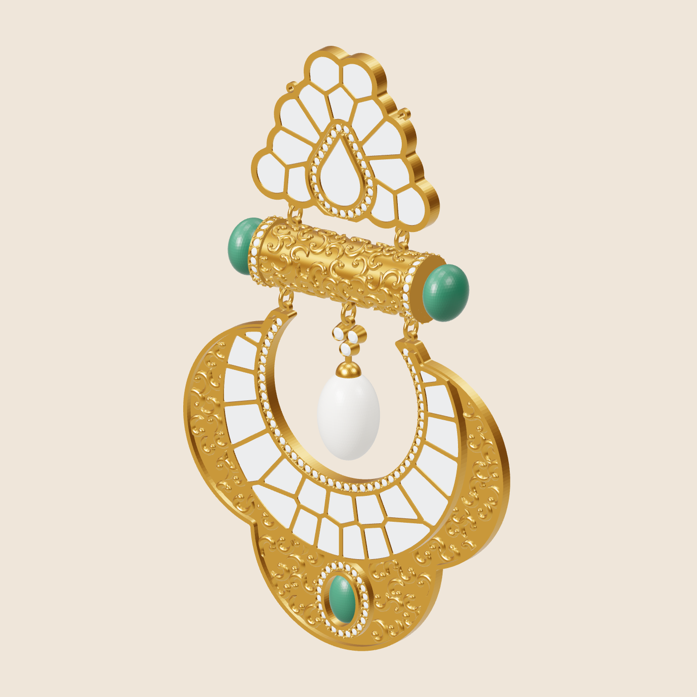
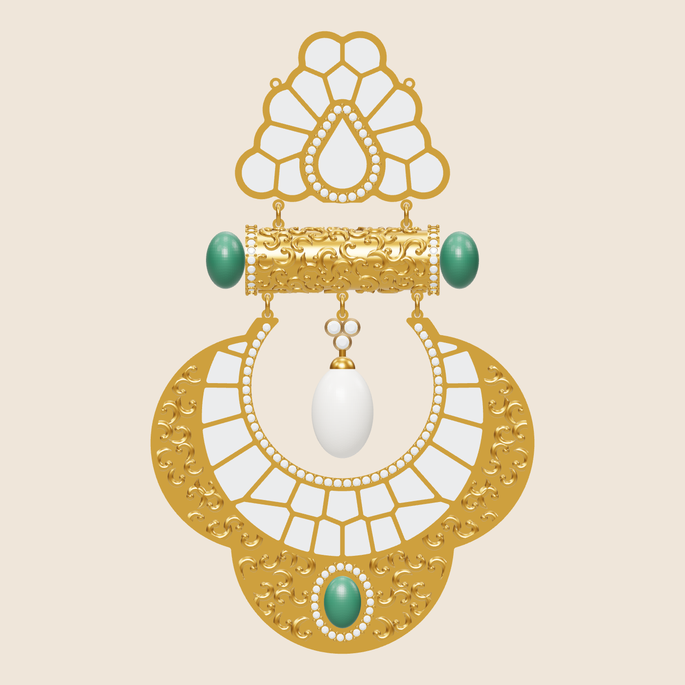
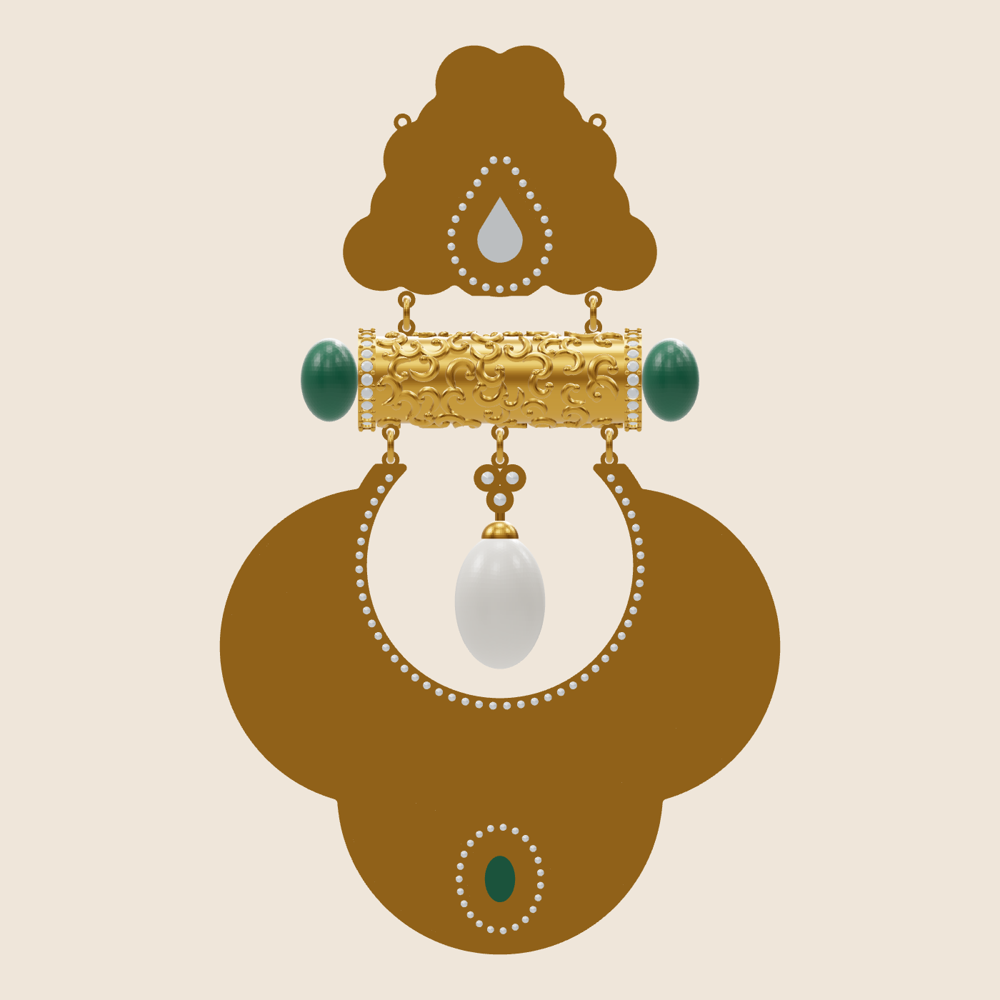
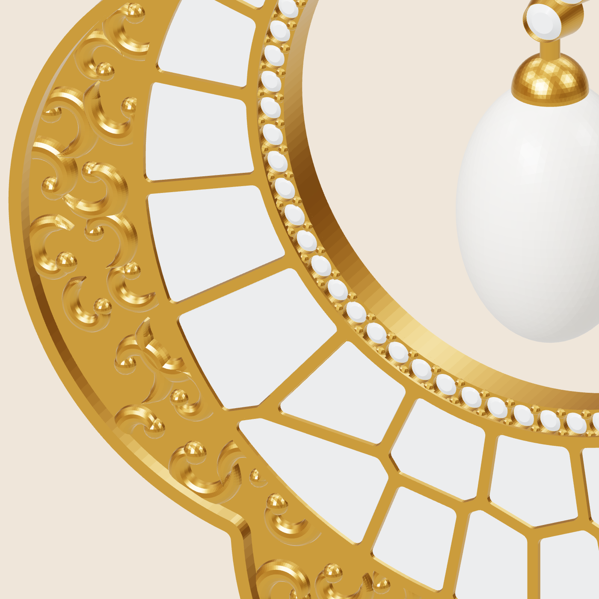

# Kundan-Polki Chandbali Pendant: parametric CAD (trial)

This is a generated 3D model of the antique-finish polki chandbali pendant set from the reference photo.
Every part is a closed, watertight solid (manifold check: `NoError`), so it is ready for Matrix / Rhino and printing.



| Front | Back (closed kundan back) | Nakashi relief close-up |
|---|---|---|
|  |  |  |

## Files (`out/`, units = mm)

| File | What it is | Qty | Volume cm³ | 22K g | 18K g |
|---|---|---|---|---|---|
| `01_chandbali.stl` | Main chandbali: lobed plate, nakashi scroll relief, 21-polki gallery, pavé ring, emerald bezel + halo | 1 | 1.369 | 24.37 | 21.22 |
| `02_top_motif.stl` | Fan motif: 13 polki + pear polki with pavé halo, chain loops | 1 | 0.554 | 9.87 | 8.59 |
| `03_barrel.stl` | Hollow engraved barrel, Ø7.9 × 25.7, pavé collars, link loops | 1 | 0.565 | 10.05 | 8.75 |
| `04_drop_cluster_cap.stl` | 3-stone cluster, stem, pearl cap with peg | 1 | 0.021 | 0.38 | 0.33 |
| `05_jump_rings_x5.stl` | All 5 jump rings (Ø0.6 wire) | 1 set | 0.011 | 0.19 | 0.17 |
| `06_chain_tube_x1.stl` | Engraved chain end tube Ø6 × 20 (make **2**) | 2 | 0.158 each | 11.25 (both) | 9.80 (both) |
| **Total metal** | | | **3.153** | **56.1 g** | **48.9 g** |

Other files:
- `00_pendant_assembly_gold.stl`: all pendant gold parts in position, for viewing or a single print.
- `ref_diamonds_polki.stl`, `ref_pearl.stl`, `ref_green_beads_emerald.stl`: stone bodies for renders only. They are **not** gold and are not counted in the weight.
- `weight_report.json`: volume, weight per alloy, bounding box and stone count for each part.

Weights are net metal from the CAD volume. They do not include casting shrinkage, sprues, or metal lost in finishing and polishing.
Densities used (g/cm³): 22K 17.80, 18K 15.50, 14K 13.00, Silver 925 10.36.

## Stone list

| Stone | Count | Size |
|---|---|---|
| Polki (chandbali) | 21 | Voronoi-cut free shapes, about 3–5 mm |
| Polki (top motif) | 13 + 1 pear | pear 6.5 × 9.4 mm |
| Pavé rounds | 69 + 25 + 44 | 1.1 mm (halo around emerald 1.0 mm) |
| Cluster rounds | 3 | 1.8 mm |
| Emerald cabochon | 1 | 5 × 7 mm oval |
| Drop pearl | 1 | 8.2 × 12.2 mm |
| Green beads at barrel ends | 2 | about 5.2 × 7.6 mm rondelle |

## Construction assumptions (all editable)

- Overall pendant size: 50.8 W × 82.3 H mm. Chandbali about 51 × 44 mm.
- Back plate 0.8 mm, closed (kundan). Polki pockets are 1.4 mm deep with 0.5 mm walls.
- Pavé seats are bright-cut style: girdle seat, 41° cone, through-hole, and grains between stones.
- Nakashi scroll relief is 0.5 mm high with a rounded profile. It is mirror-symmetric.
- Barrel and chain tubes are hollow (0.7 mm wall) with 1.2 mm stringing holes.
- Lugs are 0.8 mm thick with 0.8 mm holes. A 3.2 mm gap between parts is bridged by the jump rings.

## Changing anything

All sizes are in `PARAMS` at the top of `build.py`. Edit a value and run:

```bash
pip install manifold3d trimesh shapely scipy numpy
python3 build.py          # rewrites out/*.stl and weight_report.json (≈10 s)
```

Common changes:
- `px`: scales the whole design. 0.18 is the current size. 0.16 is about 11 % smaller and roughly 30 % lighter.
- `back`, `relief_h`, `wall_top`, `tube_wall`: the main weight drivers.
- `pave_d`, `emerald`, `pear_stone`, `drop_pearl`: match stones you actually have.
- `seed`: gives a different random scroll and curl arrangement.

The renders come from `render/` (three.js + Playwright).
