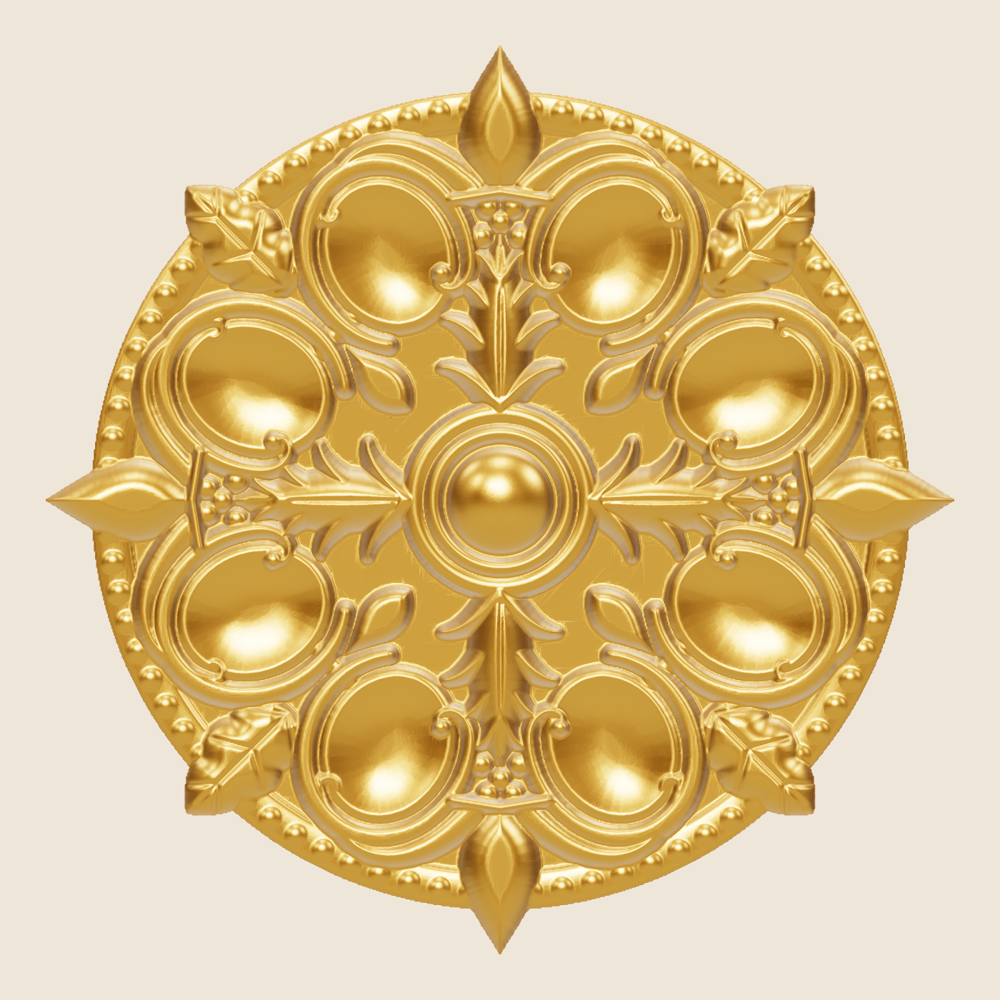
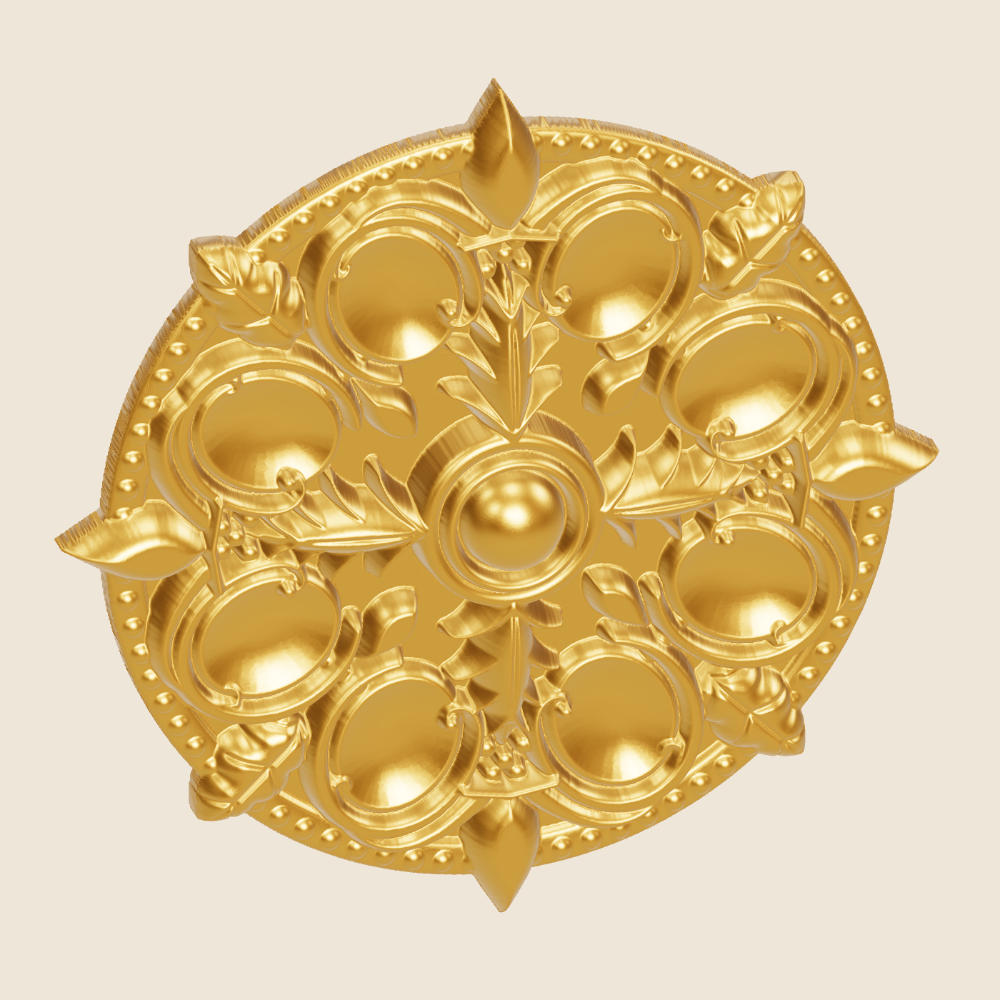
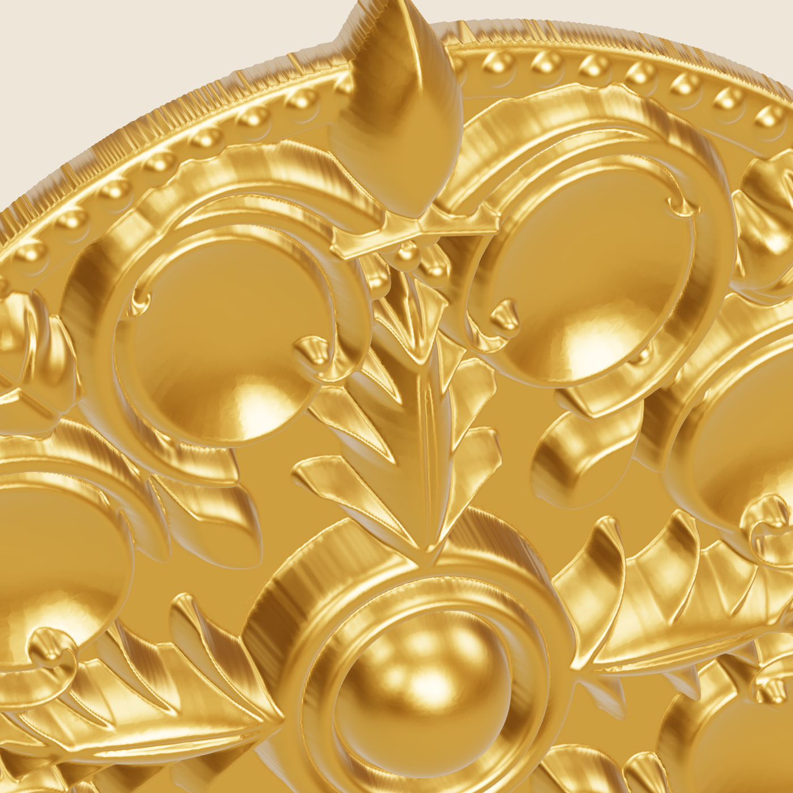
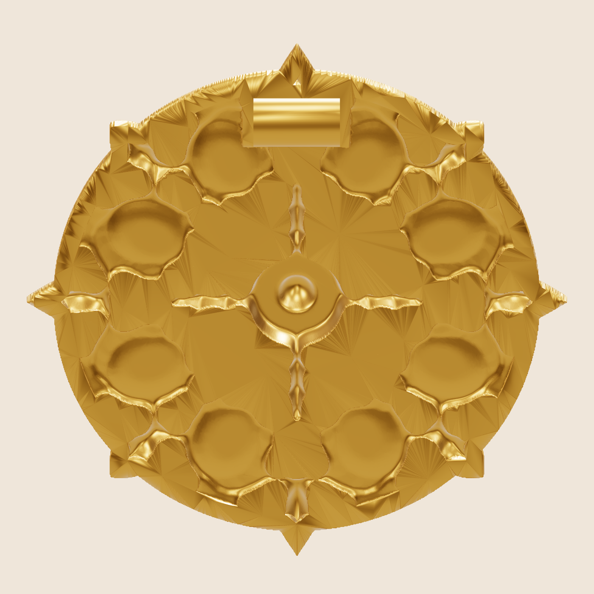
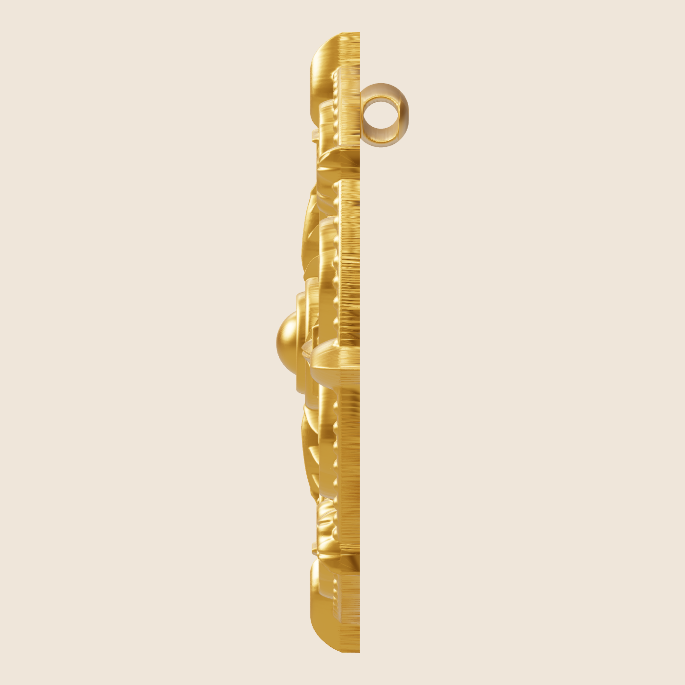

# Acanthus Rosette Medallion: parametric CAD (trial)

This is a generated 3D model of the carved rosette from the reference photo, sized as a gold pendant medallion.
It is mirror-symmetric four ways, as in the photo.



| Angle | Close-up | Back (hollowed, tube bail) | Side |
|---|---|---|---|
|  |  |  |  |

## File

`out/rosette_medallion.stl` is a single solid, in mm. Before the file is written it is checked: it must be one piece, closed (0 open edges), manifold (0 non-manifold edges) and watertight.

| | |
|---|---|
| Size | 31.2 mm tip to tip (round body 28.2 mm) |
| Relief thickness | 4.2 mm at the centre dome, 0.8 mm ground plate |
| Overall depth incl. bail | 6.65 mm |
| Metal volume | 0.925 cm³ |
| **22K** | **16.5 g** |
| 18K | 14.3 g |
| 14K | 12.0 g |
| Silver 925 | 9.6 g |

Weights are net CAD metal. They do not include sprues, casting shrinkage or polishing loss.

## What is modelled

- **Centre boss:** a domed button inside two raised rings.
- **4 acanthus leaves on the axes:** a domed spine with a vein groove, and 4 pairs of separately domed lobes that sweep out and curl.
- **5-berry clusters** at each leaf tip, 20 berries in total.
- **4 fleur buds** pointing outward, each with curled side petals and a collar.
- **4 diagonal leaves** with serrated lobes and veins, plus an inner sprig and 3 berries each.
- **8 concave petal bowls,** each framed by a rounded C-scroll band that ends in a spiral curl with an eye.
- **Beaded border:** 80 beads of 0.84 mm diameter on a raised rim band.
- **Hollow back:** the metal behind the raised relief is scooped out to a constant 0.8 mm wall, with a 1.0 mm solid border around the edge.
- **Hidden tube bail** on the back for the chain: Ø2.8 / Ø1.8 mm, 5 mm long.

## Changing it

Edit `PARAMS` at the top of `build.py`, then run `python3 build.py` (about 30 s):

```bash
pip install manifold3d trimesh shapely scipy numpy pillow matplotlib
python3 build.py
```

| Parameter | Effect |
|---|---|
| `diameter` | Overall size. All features scale with it. |
| `ground`, `wall` | Plate / wall thickness. These are the main weight drivers. |
| `hollow_back` | `False` gives a solid back: heavier, and simpler to cast. |
| `boss_top`, `leaf_h`, `bud_h`, `band_h`, `bowl_depth` | Relief depth of each element. |
| `bail` | `False` for a brooch or an inlay piece, so you can add your own finding. |
| `res` | Height-field resolution. 0.04 mm is finer than most wax printers. |

## How it is built

The front relief is a height field on a 0.04 mm grid. Each element's distance field is computed at 3× supersampling, so edges are smooth. Each element is given a rounded profile, and where elements overlap the highest one wins.
The height field is then cut to the outline and the back cavity is subtracted, using exact solid booleans (manifold3d).
A height field cannot represent undercuts. That suits casting, but it means leaf tips do not curl *over* the ground the way a hand-carved wax can.
