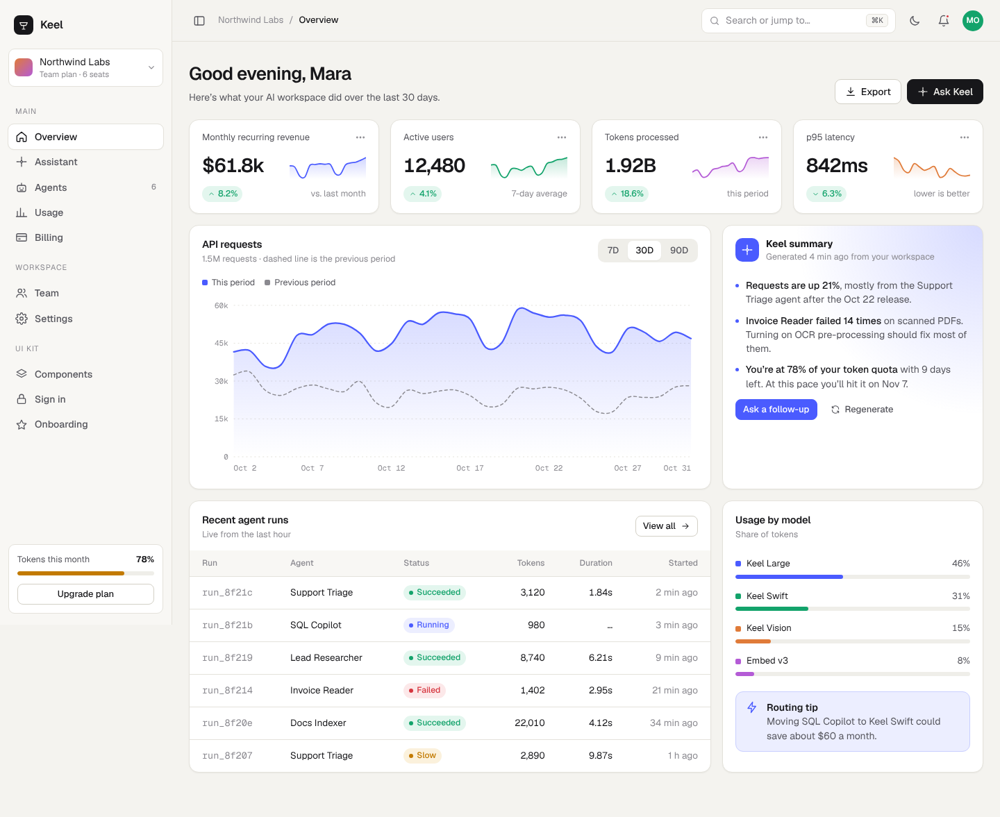
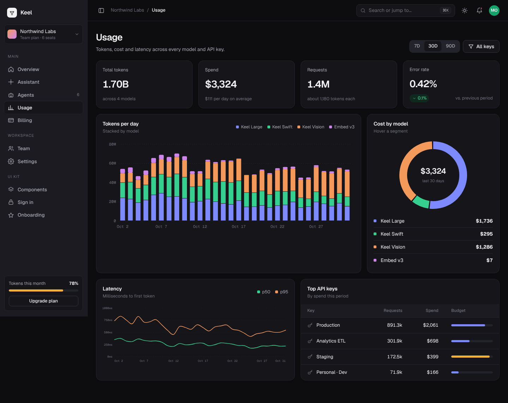
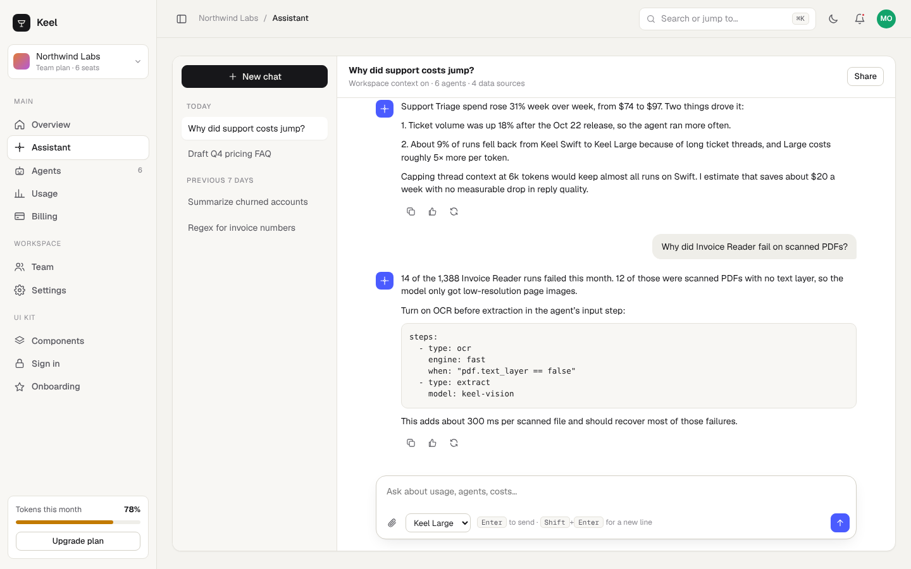
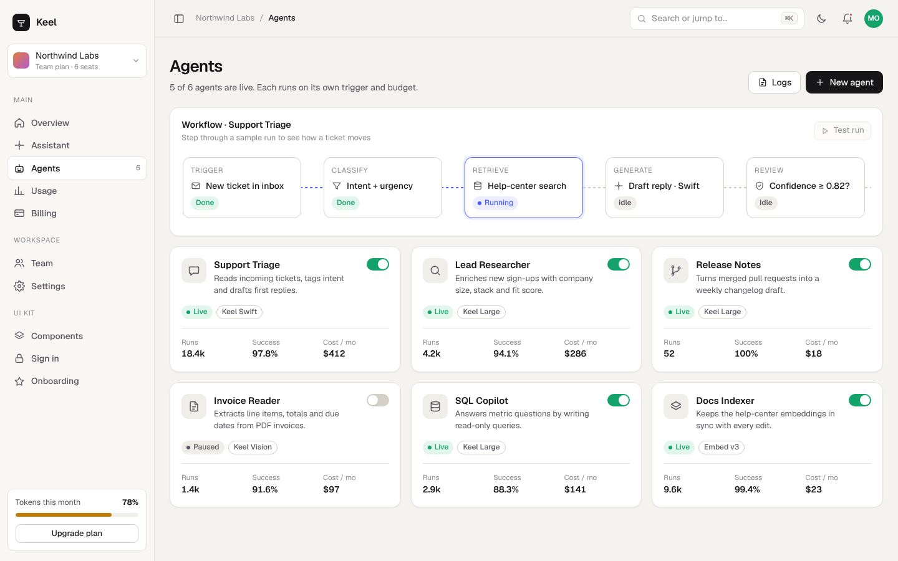
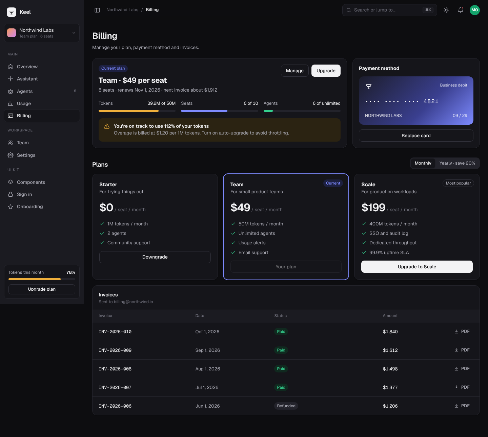

# Keel: AI SaaS dashboard kit

An original dashboard UI kit for an AI product. It's a workspace where a team watches its models, agents, usage and spend. It covers the same ground as commercial "AI SaaS dashboard" kits but has its own design and code.

Open `index.html` in a browser. There's no build step and no dependencies apart from the Geist font from Google Fonts.



## What's included

| Screen | What it shows |
|---|---|
| **Overview** | 4 KPI tiles with sparklines, a requests chart with a 7D/30D/90D switch and the previous period overlaid, an AI summary card, recent agent runs, usage by model |
| **Assistant** | Chat with a thread list, empty state with suggested prompts, streamed replies, code blocks, copy/rate/regenerate, model picker, auto-growing composer |
| **Agents** | Agent cards with a live/paused toggle and stats, plus a workflow pipeline you can step through with "Test run" |
| **Usage** | Stacked token bars by model, cost donut, p50/p95 latency lines, top API keys with budget bars |
| **Billing** | Current plan with quota meters and an overage warning, payment card, monthly/yearly plan picker, invoices |
| **Team** | Member table with search, role picker, usage share, invite modal |
| **Settings** | Tabs for General, API keys (reveal, copy, create), Notifications and Security |
| **Components** | Color tokens, type scale, buttons, inputs, selection controls, badges, avatars, progress, alerts, overlays, charts, empty state |
| **Sign in / Onboarding** | Split-screen auth and a 3-step workspace setup |

These work across the whole app:

- **Light and dark themes.** The theme follows the OS by default. Toggle it from the top bar, the profile menu, or with `Shift+D`. The choice is remembered.
- **Command menu.** Press `⌘K` or `Ctrl+K`. Arrow keys and Enter work, and if nothing matches, your text goes to the assistant.
- **Collapsible sidebar** on desktop. On phones it becomes a drawer.
- **Chart tooltips** on every chart, which are hand-written SVG with no chart library.
- Toasts, modals, dropdown menus, and a delete confirmation you have to type to enable.
- Responsive down to 390px wide, with reduced-motion support and keyboard focus rings.

## How it's built

```
index.html   page shell, fonts, theme set before first paint
styles.css   design tokens (:root + dark overrides), layout, components
app.js       icons, sample data, SVG charts, screens, router, interactions
```

- **Tokens first.** Every color, shadow and radius is a CSS variable. Dark mode just redefines the variables, so components never need theme-specific rules.
- **Screens are functions** that return HTML strings from a shared `state` object. A hash router (`#/usage`) picks the screen and re-renders.
- **One click handler** reads `data-action` attributes, so adding an interaction means adding a `case`.
- **Charts** (`lineChart`, `stackedBars`, `donut`, `sparkline`) are about 120 lines of SVG math in total. Sample data comes from a seeded random walk, so it looks the same on every load.

## Screenshots

| | |
|---|---|
|  |  |
|  |  |

All names, companies and numbers are made up.
