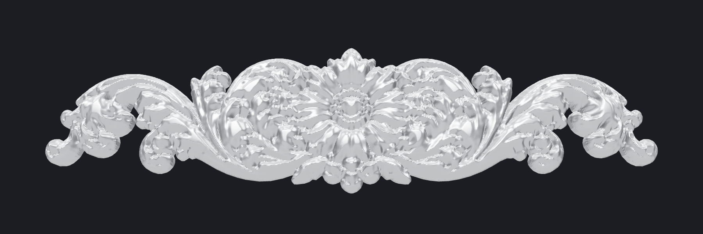

# Silver ornamental frame (3D printable)

A parametric, print-ready version of the silver frame reference (`ref/full_frame.jpg`):
2:1 outer ratio and a 1 in (25.4 mm) border on every side.

| Part | Status |
|---|---|
| Frame body (profile, rebate, keyholes, two halves) | done |
| Top / bottom centre scroll panel (`ref/top_center.webp`) | done, first pass |
| Corner rosettes | needs close-up |
| Side flowers (left/right rails) | needs close-up |
| Running scrollwork between ornaments | needs close-up |




## Files

| File | What |
|---|---|
| `frame.py` | Generator: profile sweep with mitered corners, rebate, keyholes, halves, ornament placement |
| `ornament.py` | Close-up image to flat-backed relief (silhouette + height map) |
| `preview.py` | Cross-section plot, `out/profile.png` |
| `render/` | three.js + Playwright renders (`npm i && node shoot.mjs`) |
| `out/frame_left.stl`, `out/frame_right.stl` | Frame body in two halves, 190.5 × 190.5 mm each |
| `out/frame_full.stl` | Frame body in one piece, 381 × 190.5 mm (needs a 390 mm+ bed) |
| `out/ornament_top_center.stl` | Centre panel, 70.9 × 17.4 × 3.4 mm. **Print 2**: one for the top rail and one turned 180° for the bottom |
| `out/frame_assembled.stl` | Everything fused, for viewing or for one-piece printing |

```
pip install manifold3d numpy scipy scikit-image pillow matplotlib
python frame.py                 # default: 15 x 7.5 in outer
python frame.py --width-in 20   # 20 x 10 in outer, still 1 in border
python preview.py
cd render && npm i && node shoot.mjs
```

## Dimensions (mm, defaults)

- Outer 381 × 190.5 (15 × 7.5 in). Sight opening 330.2 × 139.7 (13 × 5.5 in)
- Profile, outer to inner: small half-round bead (r 1.4, top at 14.4), cove, **flat ornament
  field 18 mm wide** at z 12 (3.8 to 21.8 mm in), inner bead + step, slope to the sight edge
- Back rebate 6.35 wide × 6.0 deep. Glass/acrylic, print and backer: 342.9 × 152.4 (13.5 × 6 in)
  less about 0.5 mm clearance
- 2 undercut keyholes in the back of the top rail (8 mm head, 4 mm neck)
- Halves: 4 alignment-pin holes (2.0 mm, 8 mm deep per side). Use 1.75 mm filament as pins
- Ornaments: flat back sits on the field. Relief up to 2.6 mm on a 0.8 mm base, so the top
  sits at about 15.4 mm, just above the outer bead

## How the ornament is made

`ornament.py` reads the close-up on a white background:
1. Silhouette: everything not connected to the white border becomes the outline
2. Height: a rounded body from the distance to the edge, plus the image's brightness
   (bright = raised). Dark outlines become grooves, and a broad blur lifts big masses
   such as the flower
3. The height field is cut to the outline, giving vertical sides and a flat back

This is an interpretation of a rendered image, not measured depth. Tune the weights in
`height_map()` if a part reads too flat or too busy.

## Printing

- **Frame halves:** face up, supports on build plate only (for the rebate ledge).
  0.16 mm layers, 3 walls, 15 % infill. Glue with pins + CA or epoxy. The seam is at
  the centre of the top and bottom rails, so the centre ornaments cover it
- **Ornaments:** flat back down, no supports. Best on a resin printer. On FDM use a
  0.2 mm nozzle and 0.08 mm layers. A 0.4 mm nozzle softens the fine leaf tips
- **Finish:** silk silver PLA, or grey primer + metallic silver + a black wash wiped back
  so the carving reads like the reference
