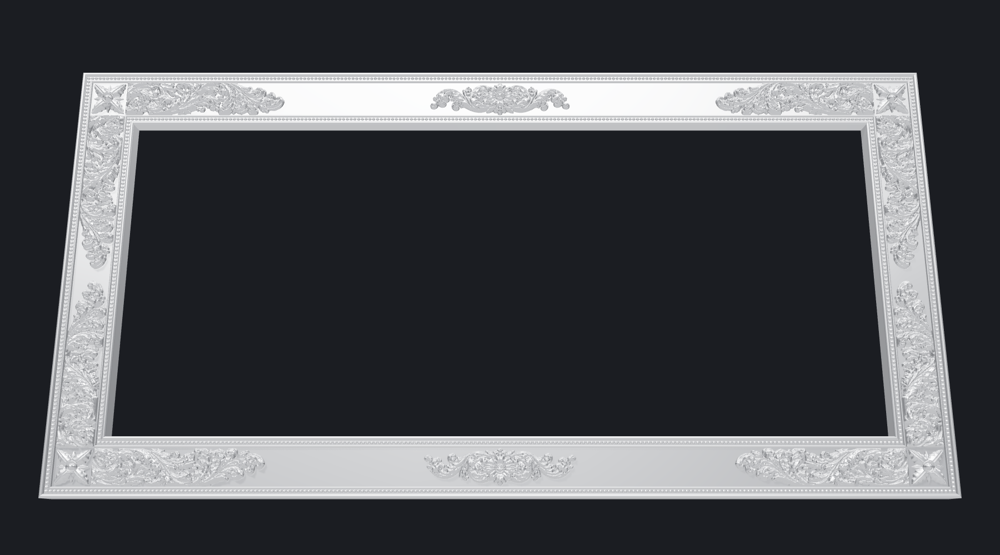
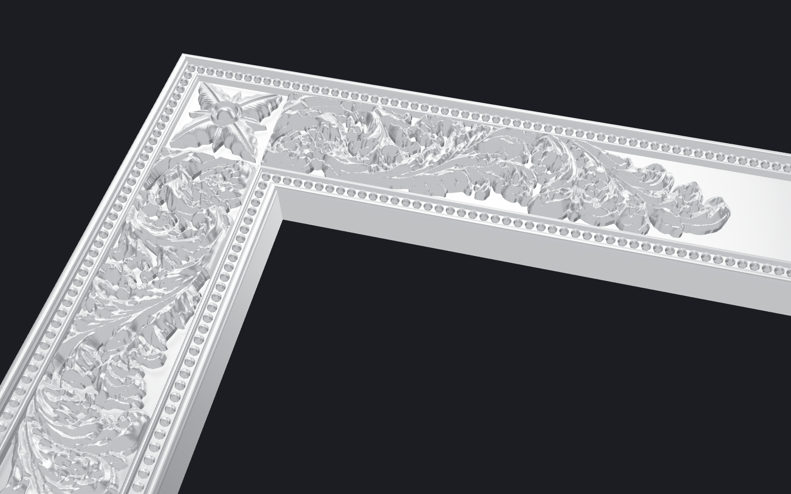

# Silver ornamental frame (3D printable)

A parametric, print-ready version of the silver frame reference (`ref/full_frame.jpg`):
2:1 outer ratio and a 1 in (25.4 mm) border on every side, with the beaded band,
corner rosettes, acanthus scrolls and centre panels from the close-ups.




## What's on it

| Element | Source | How |
|---|---|---|
| Band: outer rim, 2 rows of pearls, flat field, inner rim | `ref/corner_band.webp` | Profile measured from the close-up and swept round the frame. Pearls are real spheres, 1.44 mm on a 1.7 mm pitch |
| Corner rosette ×4 | `ref/corner_band.webp` | Modelled directly: 4 lobed petals with midrib and veins, 4 small leaves, boss and ring |
| Acanthus scroll ×8 (each corner, along both rails) | `ref/corner_band.webp` | Traced from the image (outline + height from light/shade) |
| Centre panel ×2 (top and bottom) | `ref/top_center.webp` | Traced from the image |

## Files (`out/`)

**Option 1: print it in 2 pieces, ornaments fused on** (simplest)

| File | Print |
|---|---|
| `frame_assembled_left.3mf`, `frame_assembled_right.3mf` | 1 each, 190.5 × 190.5 × 15.4 mm |

**Option 2: plain frame + separate ornaments** (sharpest detail. Print the ornaments on a resin printer or with a 0.2 mm nozzle)

| File | Print | Size (mm) |
|---|---|---|
| `frame_left.stl`, `frame_right.stl` | 1 each | 190.5 × 190.5 × 13.7 |
| `ornament_rosette.stl` | 4 | 14.3 × 14.3 × 3.4 |
| `ornament_scroll_A.stl` | 4 (top-left, bottom-right, left rail going up, right rail going down) | 71.6 × 15.5 × 3.4 |
| `ornament_scroll_B.stl` | 4 (mirror image: the other four positions) | 71.6 × 15.5 × 3.4 |
| `ornament_center.stl` | 2 (top, and bottom turned 180°). They cover the seam | 63.2 × 15.5 × 3.4 |

`frame_assembled.3mf` is the whole frame in one piece, for viewing or for a 390 mm+ bed.
`report.json` lists every part's size, volume and triangle count.

## Dimensions (mm, defaults)

- Outer 381 × 190.5 (15 × 7.5 in). Sight opening 330.2 × 139.7 (13 × 5.5 in)
- Band, outer to inner: rim 1.8 | pearl channel 2.0 | fillet 0.9 | field 16.1 | fillet 0.9 |
  pearl channel 2.0 | rim 1.7. Rims at 13.7 high, field at 12.0, ornaments up to 15.4
- Back rebate 6.35 wide × 6.0 deep. Glass/acrylic, print and backer: 342.9 × 152.4 (13.5 × 6 in)
  less about 0.5 mm clearance
- 2 undercut keyholes in the back of the top rail (8 mm head, 4 mm neck)
- The halves join at the centre of the top and bottom rails, with 4 alignment-pin holes
  (2.0 mm, 8 mm deep per side). Use 1.75 mm filament as pins, plus CA glue or epoxy

## Build

```
pip install manifold3d numpy scipy scikit-image pillow matplotlib
python frame.py                 # default: 15 x 7.5 in outer
python frame.py --width-in 20   # 20 x 10 in outer, still 1 in border
python preview.py               # cross-section plot
cd render && npm i && node shoot.mjs   # renders (needs Playwright + Chromium)
```

The side rails carry two scrolls each (71.6 mm), so the outer height must stay above
about 186 mm (7.3 in). Below that the generator warns that they overlap.

## Printing

- **Frame:** face up, supports on build plate only (for the rebate ledge). 0.12 mm layers
  so the pearls stay round, 3 walls, 15 % infill
- **Separate ornaments:** flat back down, no supports. Glue with thin CA
- **Finish:** silk silver PLA, or grey primer + metallic silver + a black wash wiped back
  so the carving reads like the reference

## Limits

The scroll and centre panel are traced from rendered images, so their depth is an
interpretation of light and shade, not measured. The scroll is the weakest: its reference
shows it on the grey band, which is harder to separate than a white background. A
white-background cut-out of the scroll, like `top_center.webp`, would make it as clean as
the centre panel.
